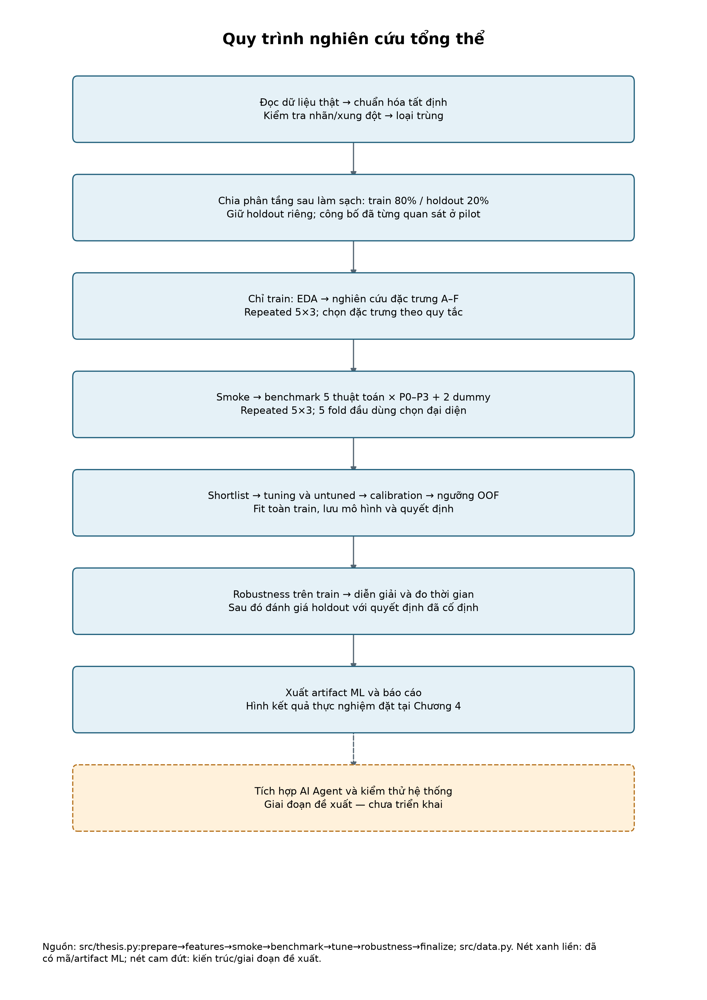
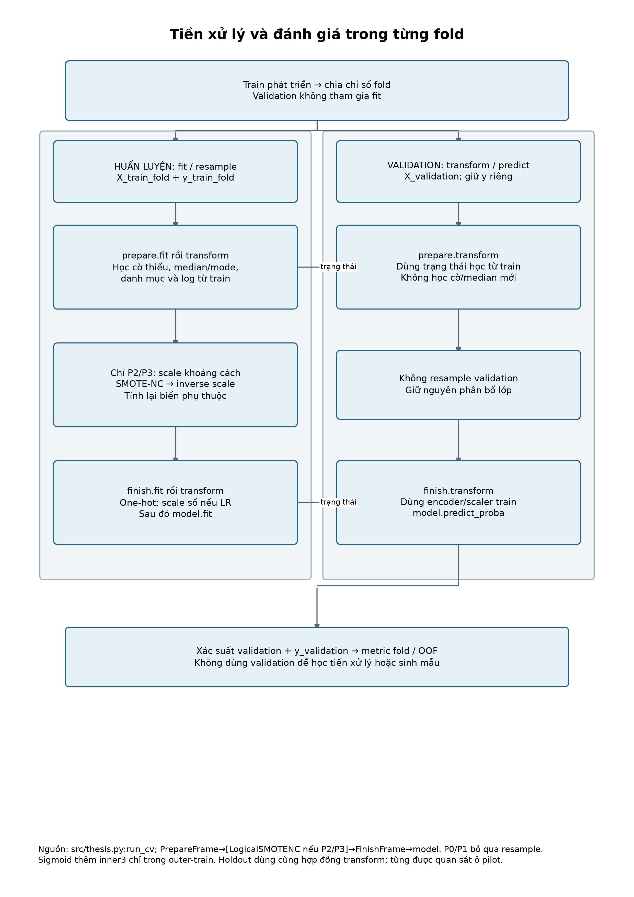
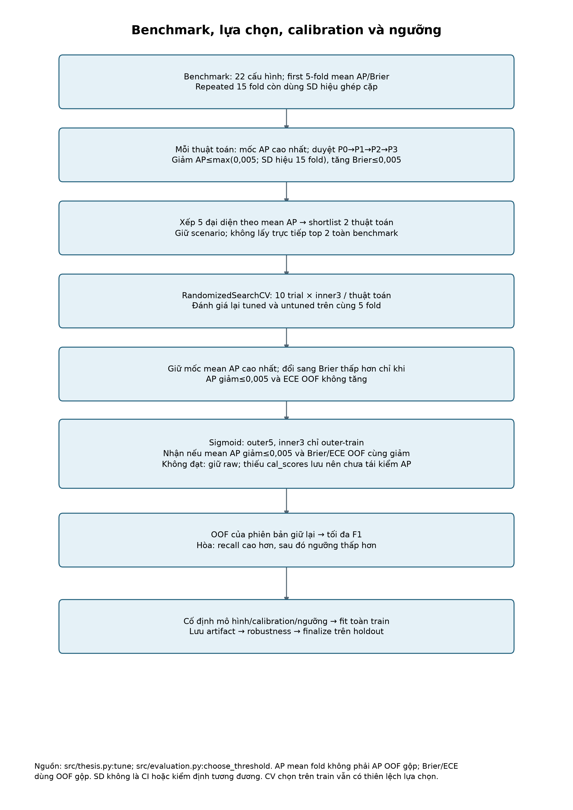
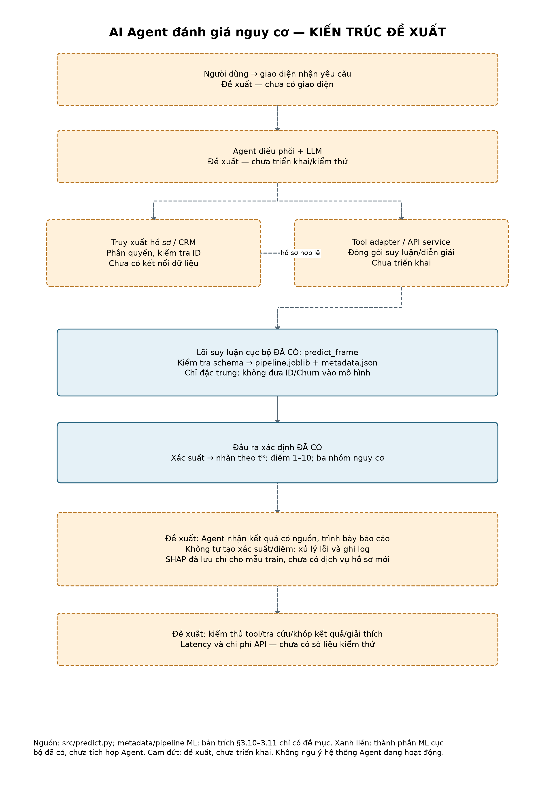

# Danh mục hình, bảng và ghi chú phương pháp — Chương 3

Tài liệu đối chiếu: `reports/thesis_extracted.txt`, phần thân đoạn 0580–1246. Chưa có Word/PDF gốc để xác nhận phiên bản mới nhất và số thứ tự sau dàn trang. Caption Bảng 3.2 chưa xuất hiện trong bản trích.

Sơ đồ có bố cục A4 dọc, định dạng SVG và PNG 300 dpi; mã Mermaid `.mmd` lưu cùng tên. Bản vẽ và Mermaid dùng chung danh sách nút/cạnh. Biểu đồ kết quả thực nghiệm thuộc Chương 4.

## Đối chiếu các bảng Chương 3

- Mục liên quan: Toàn Chương 3.
- Tệp: [tables/doi_chieu_bang.md](tables/doi_chieu_bang.md); [tables/doi_chieu_bang.csv](tables/doi_chieu_bang.csv).
- Chú thích: Đối chiếu các bảng Chương 3.
- Căn cứ: reports/thesis_extracted.txt; THESIS_ALIGNMENT.md; mã/config/artifact.
- Trạng thái: Đối chiếu bản trích hiện có; chưa xác nhận Word mới nhất.

## Danh sách và kiểu xử lý 18 biến đầu vào

- Mục liên quan: §3.2.3 — thay/cập nhật Bảng 3.1.
- Tệp: [tables/bien_dau_vao.md](tables/bien_dau_vao.md); [tables/bien_dau_vao.csv](tables/bien_dau_vao.csv).
- Chú thích: Danh sách và kiểu xử lý 18 biến đầu vào.
- Căn cứ: models/thesis_run/metadata.json; src/thesis_preprocessing.py; đoạn 0628–0665.
- Trạng thái: Xác minh kỹ thuật; không xác nhận các mô tả nghiệp vụ trong bản trích.

## Thiết kế phân chia dữ liệu và CV

- Mục liên quan: §3.4.1–3.4.2; §3.7.3.
- Tệp: [tables/chia_du_lieu_cv.md](tables/chia_du_lieu_cv.md); [tables/chia_du_lieu_cv.csv](tables/chia_du_lieu_cv.csv).
- Chú thích: Thiết kế phân chia dữ liệu và CV.
- Căn cứ: src/thesis.py:prepare,cv,benchmark,tune; split_manifest.json; thesis_config.json.
- Trạng thái: Đã xác minh từ mã/config/artifact.

## Phân bố nhãn và mẫu số mô tả dữ liệu

- Mục liên quan: §3.6.1 — cập nhật Bảng 3.6; chỉ mô tả dữ liệu.
- Tệp: [tables/phan_bo_nhan.md](tables/phan_bo_nhan.md); [tables/phan_bo_nhan.csv](tables/phan_bo_nhan.csv).
- Chú thích: Phân bố nhãn và mẫu số mô tả dữ liệu.
- Căn cứ: data_audit.json; split_manifest.json.
- Trạng thái: Đã xác minh từ mã/config/artifact.

## Quy ước thang điểm và ba nhóm nguy cơ

- Mục liên quan: §3.8.6 — cập nhật bảng nhóm chưa đánh số.
- Tệp: [tables/quy_uoc_diem_nhom.md](tables/quy_uoc_diem_nhom.md); [tables/quy_uoc_diem_nhom.csv](tables/quy_uoc_diem_nhom.csv).
- Chú thích: Quy ước thang điểm và ba nhóm nguy cơ.
- Căn cứ: thesis_config.json:risk_groups; src/scoring.py:score_probability; src/predict.py.
- Trạng thái: Đã xác minh từ mã/config/artifact.

## Thứ tự tiền xử lý và kiểm soát rò rỉ

- Mục liên quan: §3.4.3 và §3.5 — cập nhật Bảng 3.3.
- Tệp: [tables/pipeline_kiem_soat_ro_ri.md](tables/pipeline_kiem_soat_ro_ri.md); [tables/pipeline_kiem_soat_ro_ri.csv](tables/pipeline_kiem_soat_ro_ri.csv).
- Chú thích: Thứ tự tiền xử lý và kiểm soát rò rỉ.
- Căn cứ: src/data.py; src/thesis_preprocessing.py; src/thesis.py.
- Trạng thái: Đã xác minh từ mã/config/artifact.

## Thiết kế nhóm đặc trưng A–F

- Mục liên quan: §3.5.5 — phần thiết kế thay Bảng 3.5; AP thực nghiệm sang Chương 4.
- Tệp: [tables/thiet_ke_dac_trung.md](tables/thiet_ke_dac_trung.md); [tables/thiet_ke_dac_trung.csv](tables/thiet_ke_dac_trung.csv).
- Chú thích: Thiết kế nhóm đặc trưng A–F.
- Căn cứ: src/thesis.py:feature_study.
- Trạng thái: Đã xác minh từ mã/config/artifact.

## Phương án xử lý mất cân bằng P0–P3

- Mục liên quan: §3.6.3 — cập nhật Bảng 3.7.
- Tệp: [tables/phuong_an_p0_p3.md](tables/phuong_an_p0_p3.md); [tables/phuong_an_p0_p3.csv](tables/phuong_an_p0_p3.csv).
- Chú thích: Phương án xử lý mất cân bằng P0–P3.
- Căn cứ: thesis_config.json; src/thesis_preprocessing.py; src/experiment.py.
- Trạng thái: Đã xác minh từ mã/config/artifact.

## Thuật toán và tham số được khai báo tường minh

- Mục liên quan: §3.7.1–3.7.2.
- Tệp: [tables/thuat_toan_tham_so_khai_bao.md](tables/thuat_toan_tham_so_khai_bao.md); [tables/thuat_toan_tham_so_khai_bao.csv](tables/thuat_toan_tham_so_khai_bao.csv).
- Chú thích: Thuật toán và tham số được khai báo tường minh.
- Căn cứ: Mã constructor hiện có; các tham số không ghi ở đây không được suy ra từ default thư viện.
- Trạng thái: Đã xác minh từ mã/config/artifact.

## Không gian tuning khai báo cho hai thuật toán thực chạy

- Mục liên quan: §3.7.4 — thay bảng nhóm tham số dự kiến.
- Tệp: [tables/khong_gian_tuning.md](tables/khong_gian_tuning.md); [tables/khong_gian_tuning.csv](tables/khong_gian_tuning.csv).
- Chú thích: Không gian tuning khai báo cho hai thuật toán thực chạy.
- Căn cứ: src/experiment.py:model_and_space; src/thesis.py:model; tuning_*.csv.
- Trạng thái: Không gian xác minh từ mã; có 10 trial lưu mỗi thuật toán; không phải đã thử mọi tổ hợp.

## Quy tắc benchmark, chọn mô hình, calibration và ngưỡng

- Mục liên quan: §3.7.3–3.8.7.
- Tệp: [tables/quy_tac_lua_chon.md](tables/quy_tac_lua_chon.md); [tables/quy_tac_lua_chon.csv](tables/quy_tac_lua_chon.csv).
- Chú thích: Quy tắc benchmark, chọn mô hình, calibration và ngưỡng.
- Căn cứ: src/thesis.py:tune; src/evaluation.py; thesis_config.json.
- Trạng thái: Đã xác minh từ mã/config/artifact.

## Thiết kế kiểm tra độ bền, diễn giải và đo thời gian

- Mục liên quan: §3.7.5; §3.8.8; §3.9.
- Tệp: [tables/thiet_ke_dien_giai_van_hanh.md](tables/thiet_ke_dien_giai_van_hanh.md); [tables/thiet_ke_dien_giai_van_hanh.csv](tables/thiet_ke_dien_giai_van_hanh.csv).
- Chú thích: Thiết kế kiểm tra độ bền, diễn giải và đo thời gian.
- Căn cứ: src/thesis.py:robustness; src/thesis_explain.py; shap_metadata.json.
- Trạng thái: Đã xác minh từ mã/config/artifact.

## Trạng thái thành phần kiến trúc AI Agent

- Mục liên quan: §3.10.2; §3.11.
- Tệp: [tables/trang_thai_agent.md](tables/trang_thai_agent.md); [tables/trang_thai_agent.csv](tables/trang_thai_agent.csv).
- Chú thích: Trạng thái thành phần kiến trúc AI Agent.
- Căn cứ: src/predict.py; artifacts; reports/thesis_extracted.txt:1231–1245.
- Trạng thái: Lõi ML xác minh; tích hợp Agent là kiến trúc đề xuất chưa kiểm thử.

## Phiên bản môi trường được metadata ghi lại

- Mục liên quan: §3.12.
- Tệp: [tables/moi_truong_da_luu.md](tables/moi_truong_da_luu.md); [tables/moi_truong_da_luu.csv](tables/moi_truong_da_luu.csv).
- Chú thích: Phiên bản môi trường được metadata ghi lại.
- Căn cứ: models/thesis_run/metadata.json.
- Trạng thái: Đã xác minh từ mã/config/artifact.

## Quy trình nghiên cứu tổng thể

- Mục liên quan: §3.1.2.
- Tệp: [figures/hinh_01_tong_the.png](figures/hinh_01_tong_the.png); [figures/hinh_01_tong_the.svg](figures/hinh_01_tong_the.svg).
- Chú thích: Quy trình nghiên cứu tổng thể. Nguồn: src/thesis.py:prepare→features→smoke→benchmark→tune→robustness→finalize; src/data.py. Nét xanh liền: đã có mã/artifact ML; nét cam đứt: kiến trúc/giai đoạn đề xuất..
- Căn cứ: Nguồn: src/thesis.py:prepare→features→smoke→benchmark→tune→robustness→finalize; src/data.py. Nét xanh liền: đã có mã/artifact ML; nét cam đứt: kiến trúc/giai đoạn đề xuất..
- Trạng thái: Đã đối chiếu thứ tự mã thực tế.

- Mã nguồn sơ đồ: [Mermaid](figures/hinh_01_tong_the.mmd).

## Tiền xử lý và đánh giá trong từng fold

- Mục liên quan: §3.4.3; §3.5.
- Tệp: [figures/hinh_02_fold.png](figures/hinh_02_fold.png); [figures/hinh_02_fold.svg](figures/hinh_02_fold.svg).
- Chú thích: Tiền xử lý và đánh giá trong từng fold. Nguồn: src/thesis.py:run_cv; PrepareFrame→[LogicalSMOTENC nếu P2/P3]→FinishFrame→model. P0/P1 bỏ qua resample. Sigmoid thêm inner3 chỉ trong outer-train. Holdout dùng cùng hợp đồng transform; từng được quan sát ở pilot..
- Căn cứ: Nguồn: src/thesis.py:run_cv; PrepareFrame→[LogicalSMOTENC nếu P2/P3]→FinishFrame→model. P0/P1 bỏ qua resample. Sigmoid thêm inner3 chỉ trong outer-train. Holdout dùng cùng hợp đồng transform; từng được quan sát ở pilot..
- Trạng thái: Đã đối chiếu thứ tự mã thực tế.

- Mã nguồn sơ đồ: [Mermaid](figures/hinh_02_fold.mmd).

## Benchmark, lựa chọn, calibration và ngưỡng

- Mục liên quan: §3.7.3–3.8.7.
- Tệp: [figures/hinh_03_lua_chon.png](figures/hinh_03_lua_chon.png); [figures/hinh_03_lua_chon.svg](figures/hinh_03_lua_chon.svg).
- Chú thích: Benchmark, lựa chọn, calibration và ngưỡng. Nguồn: src/thesis.py:tune; src/evaluation.py:choose_threshold. AP mean fold không phải AP OOF gộp; Brier/ECE dùng OOF gộp. SD không là CI hoặc kiểm định tương đương. CV chọn trên train vẫn có thiên lệch lựa chọn..
- Căn cứ: Nguồn: src/thesis.py:tune; src/evaluation.py:choose_threshold. AP mean fold không phải AP OOF gộp; Brier/ECE dùng OOF gộp. SD không là CI hoặc kiểm định tương đương. CV chọn trên train vẫn có thiên lệch lựa chọn..
- Trạng thái: Đã đối chiếu thứ tự mã thực tế.

- Mã nguồn sơ đồ: [Mermaid](figures/hinh_03_lua_chon.mmd).

## AI Agent đánh giá nguy cơ — KIẾN TRÚC ĐỀ XUẤT

- Mục liên quan: §3.10.2.
- Tệp: [figures/hinh_04_agent.png](figures/hinh_04_agent.png); [figures/hinh_04_agent.svg](figures/hinh_04_agent.svg).
- Chú thích: AI Agent đánh giá nguy cơ — KIẾN TRÚC ĐỀ XUẤT. Nguồn: src/predict.py; metadata/pipeline ML; bản trích §3.10–3.11 chỉ có đề mục. Xanh liền: thành phần ML cục bộ đã có, chưa tích hợp Agent. Cam đứt: đề xuất, chưa triển khai. Không ngụ ý hệ thống Agent đang hoạt động..
- Căn cứ: Nguồn: src/predict.py; metadata/pipeline ML; bản trích §3.10–3.11 chỉ có đề mục. Xanh liền: thành phần ML cục bộ đã có, chưa tích hợp Agent. Cam đứt: đề xuất, chưa triển khai. Không ngụ ý hệ thống Agent đang hoạt động..
- Trạng thái: Kiến trúc đề xuất, phân biệt lõi ML đã có/chưa có.

- Mã nguồn sơ đồ: [Mermaid](figures/hinh_04_agent.mmd).

## Ghi chú đối chiếu

Thiết kế kiểm định và nhóm đặc trưng của Bảng 3.4–3.5 thuộc phương pháp nghiên cứu; p/q, AP, delta và kết luận thực nghiệm thuộc Chương 4. Phân bố nhãn là thống kê mô tả dữ liệu, có mẫu số và phạm vi riêng.

Phiên bản thư viện được ghi trong metadata. Số chiều và số cờ thiếu xác nhận ở lần fit toàn train không đại diện cho mọi fold. Quy tắc chọn đại diện sử dụng SD hiệu AP trên 15 fold; bản trích mới mô tả chênh lệch AP 0,005. Bảng tham số chỉ ghi các giá trị có căn cứ từ mã/config/artifact.

## Chưa xác minh / cần bổ sung

Word mới nhất và số trang/bảng sau dàn trang; tài liệu xác nhận nhãn, đơn vị Tenure/khoảng cách/tiền tệ, horizon và thời điểm hình thành biến; tính tương đương alias Mobile/Mobile Phone; cờ/số chiều từng fold; cal_scores/OOF sigmoid; CPU/OS/tải lúc đo; thiết kế chi tiết và kiểm thử Agent. §3.10–3.11 hiện chỉ là đề mục trong bản trích, sơ đồ là đề xuất kỹ thuật từ lõi ML và phạm vi đã nêu, không phải mô tả triển khai.

## Phạm vi tổng hợp

Hình và bảng được tổng hợp từ mã nguồn và artifact đã lưu. Dữ liệu thực nghiệm, mô hình và văn bản luận văn gốc không thay đổi; không phát sinh huấn luyện, suy luận hoặc bootstrap mới.